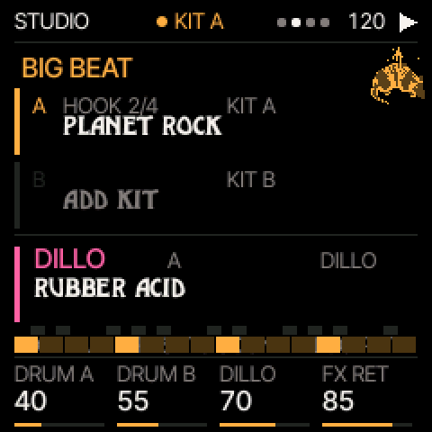
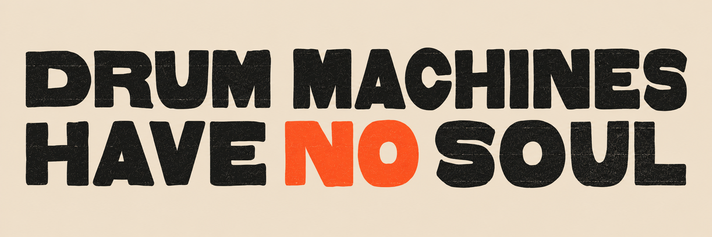

# BB1 for FM-1

**An ode to drum machines.**

Two drum layers. Dillo on bass. Echo and spring. Pick a kit, find a pattern and play. Then see how far you can push it.

BB1 grew out of the collection and research behind [Drum Machines Have No Soul](https://drummachineshavenosoul.com/). We have the machines. We care about the machines. That is why we built this.

**Development preview.** The current source candidate is r9.8; hardware acceptance and a qualified public installer are still in progress. No firmware download is offered here yet.

[The Big Beat](https://thebigbeat.app/) · [Try the browser emulator](https://thebigbeat.app/fm1/emulator/) · [First play](docs/QUICKSTART.md) · [Kits and compatibility](docs/KITS.md)

*Host render of the firmware drawing code, from the r9.5 illustrated guide, with example data. This is not a hardware photograph or verification of the loaded kit.*

## Inside the box

| Part | What you play |
| --- | --- |
| Big Beat A + B | Two drum layers, each with its own kit, pattern and level |
| Dillo | Bass sounds and phrases; cutoff, resonance, envelope and decay on the main knob page |
| Echo + spring | Shared effects with instrument sends and a wet return |
| Studio | A level, B level, Dillo level and FX return on four labelled knobs |

The current candidate has four kit choices: **native 808 synthesis**, plus selected **LinnDrum**, **DrumTraks** and **DMX** sample sets. Two layers play together. See the [compatibility notes](docs/KITS.md) for substitutions and differences from the original machines.

The r9.8 catalogue contains **67 song titles / 295 song sections**, **138 Roland presets on four shelves**, and **168 era sections across 21 eras**: **601 sections in total**, all loaded in host checks. These are catalogue references, not recordings or artist endorsements. Host checks do not establish hardware acceptance.

The browser emulator is an older r9 preview with 21 song titles. It does not load the sampled-kit library, reproduce exact panel layout/key LEDs, or model hardware timing and CPU load. The illustrated guide uses r9.5 screens. Check the version you are playing.

## Meet the machines

The collection gives BB1 a starting point, not a promise to reproduce every original circuit or feature. Explore the instruments and their histories:

- [Roland TR-808](https://drummachineshavenosoul.com/museum/roland-tr-808/)
- [LinnDrum](https://drummachineshavenosoul.com/museum/linndrum/)
- [Sequential DrumTraks](https://drummachineshavenosoul.com/museum/sequential-drumtraks/)
- [Oberheim DMX](https://drummachineshavenosoul.com/museum/oberheim-dmx/)

## Installation and source

The public installer, versioned firmware and complete matching source package will accompany a qualified release. A short demo, successful build or browser preview does not qualify an installation. Keep your projects and settings backed up, and follow the release-specific recovery instructions when they are published.

This repository currently contains the launch documentation and imagery. It does not contain firmware binaries, sample-library images or a complete firmware build tree. Original software licences and sound/artwork notices must accompany the source release; see [credits and notices](docs/CREDITS.md).

## The Big Beat family

| Instrument | Start here |
| --- | --- |
| BB1 | Firmware for the FM-1; explore the browser preview above |
| Big Beat Studio | [Play the browser studio](https://thebigbeat.app/studio): drums, synths and a mixing desk |
| BB–23 | [Open the BPM calculator](https://thebigbeat.app/bpm-machine): listen, tap and find the pulse |

