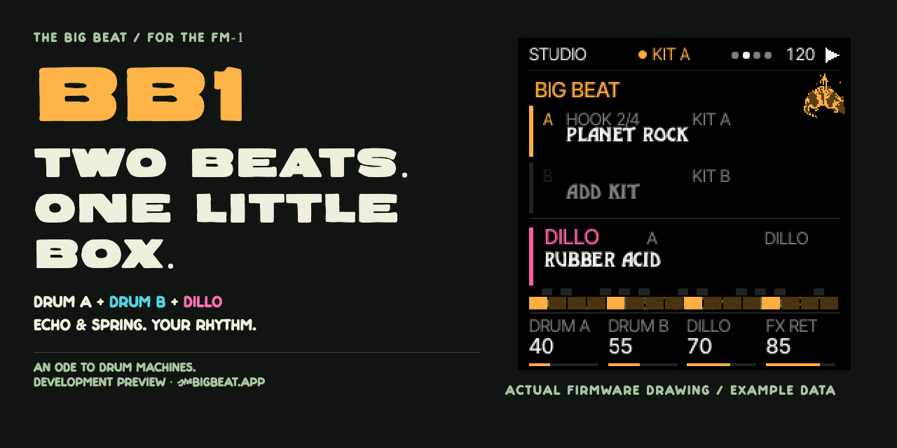
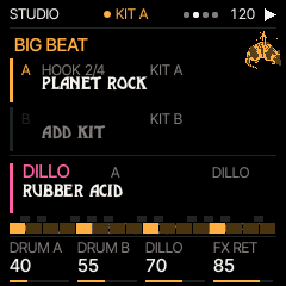
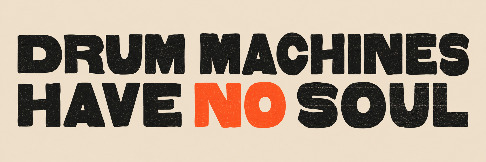

# BB1 for FM-1

**An ode to drum machines.**

Two drum layers. Dillo on bass. A full effects chain — delay, reverb, seven distortions, a compressor. Pick a kit, find a pattern and play. Then see how far you can push it.

BB1 grew out of the collection and research behind [Drum Machines Have No Soul](https://drummachineshavenosoul.com/). We have the machines. We care about the machines. That is why we built this.

[The Big Beat](https://thebigbeat.app/) · [Try the browser emulator](https://thebigbeat.app/fm1/emulator/) · [First play](docs/QUICKSTART.md) · [Kits and compatibility](docs/KITS.md) · [What's new in 2.3](docs/CHANGELOG.md)

*Host render of the firmware drawing code, from the r9.5 illustrated guide, with example data. This is not a hardware photograph or verification of the loaded kit.*

## Inside the box

| Part | What you play |
| --- | --- |
| Big Beat A + B | Two drum layers, each with its own kit, pattern and level |
| Dillo | Bass sounds and phrases; kick-aware bass response in 2.3 |
| Effects chain | Delay (DIGI/TAPE), room reverb, seven distortions, glue compressor |
| Studio | A level, B level, Dillo level and FX return on four labelled knobs |

Four kit choices: **native 808 synthesis**, plus selected **LinnDrum**, **DrumTraks** and **DMX** sample sets. Two layers play together. See the [compatibility notes](docs/KITS.md) for substitutions and differences from the original machines.

The catalogue contains **67 song titles / 295 song sections**, **138 Roland presets on four shelves**, and **168 era sections across 21 eras**: **601 sections in total**. These are catalogue references, not recordings or artist endorsements.

The browser emulator is an older r9 preview with 21 song titles. It does not load the sampled-kit library, reproduce exact panel layout/key LEDs, or model hardware timing and CPU load. Check the version you are playing.

## Meet the machines

The collection gives BB1 a starting point, not a promise to reproduce every original circuit or feature. Explore the instruments and their histories:

- [Roland TR-808](https://drummachineshavenosoul.com/museum/roland-tr-808/)
- [LinnDrum](https://drummachineshavenosoul.com/museum/linndrum/)
- [Sequential DrumTraks](https://drummachineshavenosoul.com/museum/sequential-drumtraks/)
- [Oberheim DMX](https://drummachineshavenosoul.com/museum/oberheim-dmx/)

## Installation and source

Install from [thebigbeat.app](https://thebigbeat.app/). Keep your projects and settings backed up, and follow the recovery instructions for your version.

Original software licences and sound/artwork notices accompany the source release; see [credits and notices](docs/CREDITS.md).

## The Big Beat family

| Instrument | Start here |
| --- | --- |
| BB1 | Firmware for the FM-1; explore the browser preview above |
| [Compás](https://thebigbeat.app/compas/) | Latin rhythm section for the FM-1: cumbia, son, merengue, bolero and more |
| [BB–37](https://github.com/TexasRADIO/telegram-101-elite) | Telegram 101 Elite: groovebox firmware for the SMK-37 Elite |
| Big Beat Studio | [Play the browser studio](https://thebigbeat.app/studio): drums, synths and a mixing desk |
| BB–23 | [Open the BPM calculator](https://thebigbeat.app/bpm-machine): listen, tap and find the pulse |

